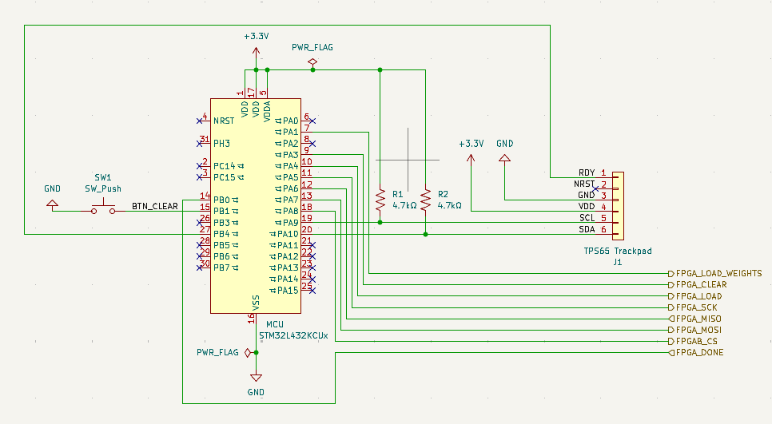

## Status Summary

### FPGA

The FPGA has been partially completed. The BNN module was completed and verified against a set of testvectors. Multiple testbenches were used to verify the BNN’s behavior. One test bench tested the BNN_core, which does the prediction. Another test bench simulated a full SPI transaction. The testbench confirmed that the BNN would correctly predict and send back the result over SPI. The BNN verilog was simulated and debugged in Questa.

The BNN was flashed to the FPGA, and completed a SPI transaction on real hardware with a simple script that sent over hardcoded image data. Oscope probes show a time of 1.4ms for the inference, with the SPI transaction being the limiting factor for speed.

To meet the final deliverable, we still need to develop the VGA display module and find a VGA display. We also need to tie the second FPGA to the first via SPI. The Hex displays need to be wired to the FPGA output.

### MCU

The MCU firmware has similarly been partially completed. The peripheral drivers (USART2, I2C, SPI1, external interrupts, etc.) for the STM32L432KC have been written and run on the board. The rasterizer (converts captured stroke into bitmap for BNN) was verified against the training vectors.

A laptop test suite, verified the firmware stages before running them on hardware. A C model of the BNN reproduced the python model’s predictions and all 47 output scores on every test image.

- The stroke-capture state machine was tested on multi-stroke characters, the 500 ms end-of-character gap, and brief finger dropouts.
- The SPI protocol was tested against a bit-level model of the FPGA_A’s SPI slave: the weights arrived intact, all 16 test images were received word for word, and every predicted class was read back correctly.
- A live UART view that shows the user’s trace beside the bitmap sent to the FPGA was written and tested on the laptop with replayed strokes via screen session on local terminal

On hardware, the MCU loads the trained model weights (121,792 bytes stored in flash) into the FPGA at every boot, in 341 ms (notional latency). It then sent the 16 test images to the FPGA over SPI and read back each prediction: 9 of 16 matched the expected classes. We are debugging link errors until we can reliably match 16/16 classes.

*We replaced the Trill Square with an Azoteq TPS65 trackpad, which arrives this week. Because of that, the touchpad driver and stroke capture have not yet been verified on real handwriting.*

To meet the final deliverable, we still need to write the TPS65 driver, fix the remaining SPI errors, and write the main loop that connects touch input, stroke capture, rasterization and classification.

## System Block Diagram

{#fig-system-block}

## Breadboard Schematics

{#fig-schematic-mcu}

{#fig-schematic-fpga-a}

{#fig-schematic-display-driver}

## FPGA Block Diagrams

### BNN block diagram

At start, the MCU asserts load_weights, then sends all the weights over SPI to the FPGA. The FPGA takes the weights and stores them in the SPRAM. After this the FPGA is ready to receive images for processing.

When the MCU needs to make a prediction, it sends the entire image data over SPI while load weights = 0. As soon as load falls, the BNN started calculating. When it's done, it raises the done flag, and the MCU can read back the resulting class to confirm its correctness.

## MCU Routine Outline

1. Boot and weight load: sets up clock and peripherals, after waiting a set delay for the fpga to do the same, then  loads the trained model weights from flash memory into the FPGA (once per every power up).
2. Touchpad Sampling: reads finger/stylus position from the TPS65 trackpad over I2C whenever a new sample is detected.
3. Stroke Capture: collects and processes the sent over samples into “strokes” and determines if and when a character is finished being written (currently waiting 500ms after the last sample).
4. Rasterizer: turn the finished character (strokes) into a centered 28x28 bitmap (the same the network was trained on).
5. FPGA link (for inference): sends the bitmap to FPGA_A over SPI, waits for results, and reads back the predicted class.
6. UART Debug: sends the result to a terminal “screen” session on a laptop over UART2 protocol. Displays the bitmap sent to the fpga for inference, and the live trace from the trackpad.
7. User Interface: coordinates the status leds of the MCU and the CLEAR button

**Chronology**

Routine 1 happens only once per session.

Routines 4,5, and 6\* run sequentially as each relies on the output of the other (6\*: the bitmap sent and final result class return rely on routine 4 and 5.)

Routines 2, 3, and 6\* are concurrent meaning as the user is writing, they run together (6\* the live trace the user’s finger/stylus, CLEAR button debounce, and status LED0.

## Riskiest Element

The proposal named the binarized neural network (BNN) as the riskiest part of the project. The BNN Verilog is now finished and verified on hardware, so that risk is behind us.

Fitting the network on the FPGA was the main design challenge. Because every weight is a single bit, we could calculate exactly how much memory the weights would take. We stored them in SPRAM instead of flash so inference would run faster.

During training we tried many combinations of layer count and layer width. The best runs reached nearly 90% accuracy on the test data. We kept the most accurate configuration that fit in memory. The final configuration was three layers of 512 neurons followed by the output layer.

To verify the BNN, we checked its predictions on 16 images, each of a different letter. We also have a test suite of 5,000 images, but time constraints kept the simulation to those 16.

## Parts Status

| **Part** | **Vendor** | **Qty** | **Ordered** | **Received** | **Cost** |
|---|---|---|---|---|---|
| TPS65-201A-S Azoteq Capacitance Touch Sensor Modules | Mouser | 2 | Yes | No | 23.10 |
| Seven Seg Displays | DigiKey | 4 | Yes | Yes | \$23.13 |
| **Total** | | | | | **\$46.23** |
