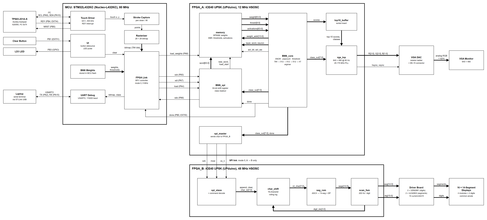
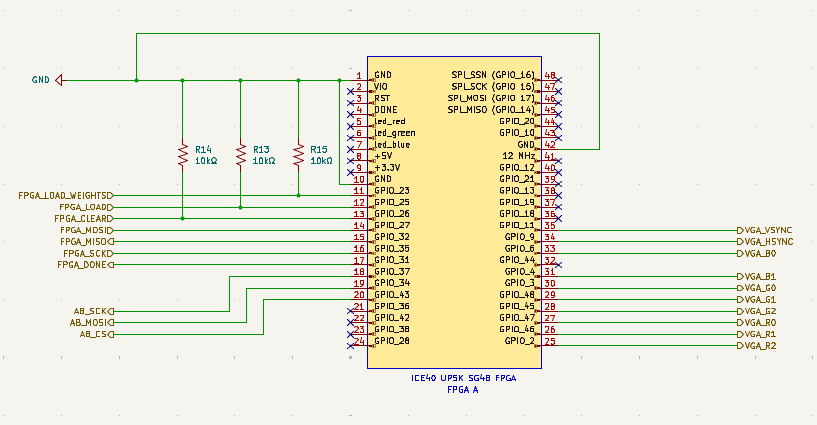
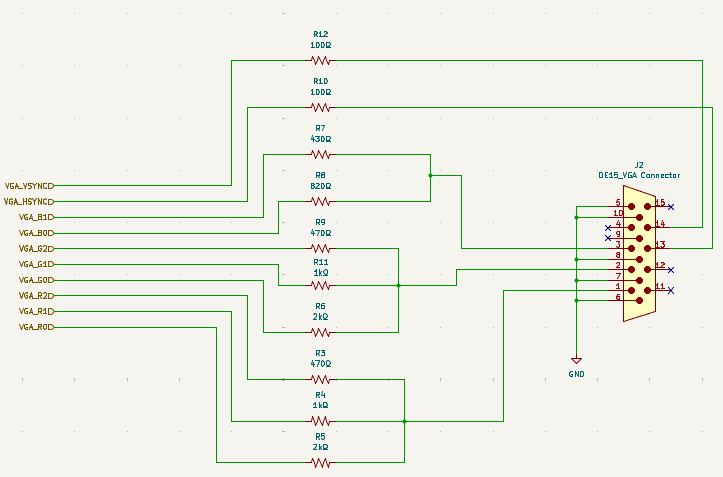
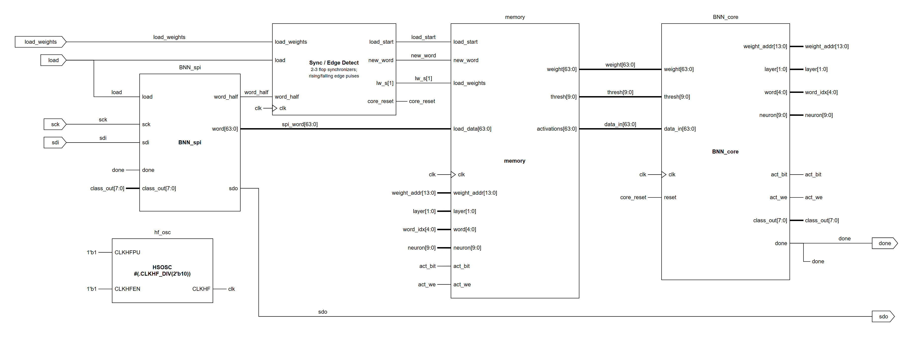

## Status Summary

### FPGA

The FPGA has been partially completed. The BNN module was completed and verified against a set of testvectors. Multiple testbenches were used to verify the BNN’s behavior. One test bench tested the BNN_core, which does the prediction. Another test bench simulated a full SPI transaction. The testbench confirmed that the BNN would correctly predict and send back the result over SPI. The BNN verilog was simulated and debugged in Questa.

The BNN was flashed to the FPGA, and completed a SPI transaction on real hardware with a simple script that sent over hardcoded image data. Oscope probes show a time of 1.4ms for the inference, with the SPI transaction being the limiting factor for speed.

To meet the final deliverable, we still need to develop the VGA display module and find a VGA display. We also need to tie the second FPGA to the first via SPI. The Hex displays need to be wired to the FPGA output.

### MCU

The MCU firmware has similarly been partially completed. The peripheral drivers (USART2, I2C, SPI1, external interrupts, etc.) for the STM32L432KC have been written and run on the board. The rasterizer (converts captured stroke into bitmap for BNN) was verified against the training vectors.

A laptop test suite, verified the firmware stages before running them on hardware. A C model of the BNN reproduced the python model’s predictions and all 47 output scores on every test image.

- The stroke-capture state machine was tested on multi-stroke characters, the 500 ms end-of-character gap, and brief finger dropouts.
- The SPI protocol was tested against a bit-level model of the FPGA_A’s SPI slave: the weights arrived intact, all 16 test images were received word for word, and every predicted class was read back correctly.
- A live UART view that shows the user’s trace beside the bitmap sent to the FPGA was written and tested on the laptop with replayed strokes via screen session on local terminal

On hardware, the MCU loads the trained model weights (121,792 bytes stored in flash) into the FPGA at every boot, in 341 ms (notional latency). It then sent the 16 test images to the FPGA over SPI and read back each prediction: 9 of 16 matched the expected classes. We are debugging link errors until we can reliably match 16/16 classes.

*We replaced the Trill Square with an Azoteq TPS65 trackpad, which arrives this week. Because of that, the touchpad driver and stroke capture have not yet been verified on real handwriting.*

To meet the final deliverable, we still need to write the TPS65 driver, fix the remaining SPI errors, and write the main loop that connects touch input, stroke capture, rasterization and classification.

## System Block Diagram

{#fig-system-block}

## Breadboard Schematics

{#fig-schematic-mcu}

{#fig-schematic-fpga-a}

{#fig-schematic-display-driver}

## FPGA Block Diagrams

### BNN block diagram

{#fig-bnn-top}

At start, the MCU asserts load_weights, then sends all the weights over SPI to the FPGA. The FPGA takes the weights and stores them in the SPRAM. After this the FPGA is ready to receive images for processing.

When the MCU needs to make a prediction, it sends the entire image data over SPI while load weights = 0. As soon as load falls, the BNN started calculating. When it's done, it raises the done flag, and the MCU can read back the resulting class to confirm its correctness.

## MCU Routine Outline

1. Boot and weight load: sets up clock and peripherals, after waiting a set delay for the fpga to do the same, then  loads the trained model weights from flash memory into the FPGA (once per every power up).
2. Touchpad Sampling: reads finger/stylus position from the TPS65 trackpad over I2C whenever a new sample is detected.
3. Stroke Capture: collects and processes the sent over samples into “strokes” and determines if and when a character is finished being written (currently waiting 500ms after the last sample).
4. Rasterizer: turn the finished character (strokes) into a centered 28x28 bitmap (the same the network was trained on).
5. FPGA link (for inference): sends the bitmap to FPGA_A over SPI, waits for results, and reads back the predicted class.
6. UART Debug: sends the result to a terminal “screen” session on a laptop over UART2 protocol. Displays the bitmap sent to the fpga for inference, and the live trace from the trackpad.
7. User Interface: coordinates the status leds of the MCU and the CLEAR button

**Chronology**

Routine 1 happens only once per session.

Routines 4,5, and 6\* run sequentially as each relies on the output of the other (6\*: the bitmap sent and final result class return rely on routine 4 and 5.)

Routines 2, 3, and 6\* are concurrent meaning as the user is writing, they run together (6\* the live trace the user’s finger/stylus, CLEAR button debounce, and status LED0.

## Riskiest Element

The proposal named the binarized neural network (BNN) as the riskiest part of the project. The BNN Verilog is now finished and verified on hardware, so that risk is behind us.

Fitting the network on the FPGA was the main design challenge. Because every weight is a single bit, we could calculate exactly how much memory the weights would take. We stored them in SPRAM instead of flash so inference would run faster.

During training we tried many combinations of layer count and layer width. The best runs reached nearly 90% accuracy on the test data. We kept the most accurate configuration that fit in memory. The final configuration was three layers of 512 neurons followed by the output layer.

To verify the BNN, we checked its predictions on 16 images, each of a different letter. We also have a test suite of 5,000 images, but time constraints kept the simulation to those 16.

## Parts Status

| **Part** | **Vendor** | **Qty** | **Ordered** | **Received** | **Cost** |
|---|---|---|---|---|---|
| TPS65-201A-S<br>Azoteq Capacitance Touch Sensor Modules | Mouser | 2 | Yes | No | \$23.10 |
| Seven Seg Displays | DigiKey | 4 | Yes | Yes | \$23.13 |
| **Total** | | | | | **\$46.23** |

## Appendix C: MCU Code

From the `murphy` branch (commit [`4c06743`](https://github.com/E155-Final-Project/final-project/tree/4c06743ee0ebf9ed0d6a925d213c37a00ef4087b/project_mcu/src)).

<details>
<summary><code>main.c</code></summary>

[View on GitHub](https://github.com/E155-Final-Project/final-project/blob/4c06743ee0ebf9ed0d6a925d213c37a00ef4087b/project_mcu/src/app/main.c)

````{.c filename="main.c"}
// main.c
// E155 final project -- MCU firmware hardware smoke test.
//
// What this build does:
//   1. Boot: configureClock() -> 80 MHz, SysTick 1 kHz, USART2 @ 115200 to the
//      ST-Link virtual COM port, LD3 as output, EXTI0/1 armed on PB0 / PB1.
//   2. In the main loop: blink LD3 at ~1 Hz and print "hello e155 <ms>\r\n"
//      once a second. A button press on PB1 prints a notice. A "done" rising
//      edge on PB0 also prints a notice.
//   3. Periodically runs an I2C scan (0x08..0x77) and prints ACKing addresses.
//   4. One-shot at boot: rasterize the hardcoded 'a' stroke and print the
//      28x28 bitmap over UART so bitmap_print() is exercised on-target.
//
// The portable src/ files (rasterize, bitmap_print, config.h, bitmap.h,
// classes, live_view) include nothing from lib/. Only main.c and future
// hardware modules reach into lib/.

#include <stdint.h>
#include <stdio.h>

#include "STM32L432KC.h"
#include "pins.h"

#include "bitmap.h"
#include "bitmap_print.h"
#include "rasterize.h"
#include "strokes_mcu.h"
#include "ui.h"
#include "fpga_link.h"
#include "smoke_vectors.h"
#include "classes.h"

static void run_link_test(void)
{
    char line[80];

    delay_ms(500);                      // let FPGA_A finish configuring from flash

    uint32_t t0 = millis();
    fpga_load_weights();
    snprintf(line, sizeof line, "\r\nweights: %lu ms\r\n", (unsigned long)(millis() - t0));
    uart_puts(line);

    int pass = 0;
    for (int n = 0; n < SMOKE_N; n++) {
        uint8_t cls = 0xEE;
        fpga_status_t s = fpga_classify(SMOKE_IMAGES[n], &cls);
        int ok = (s == FPGA_OK && cls == SMOKE_EXPECTED[n]);
        pass += ok;
        snprintf(line, sizeof line, "img %2d: %-24s got %c (%3u)  want %c  %s\r\n",
                 n, fpga_status_str(s),
                 class_char(cls), cls, class_char(SMOKE_EXPECTED[n]),
                 ok ? "ok" : "MISMATCH");
        uart_puts(line);
    }
    snprintf(line, sizeof line, "smoke over SPI: %d/16\r\n", pass);
    uart_puts(line);
}


static void boardInit(void) {
    configureClock();                   // 80 MHz, 4 WS flash, PLL
    systickInit();                      // 1 kHz tick

    // Core peripherals.
    initUSART(USART2_ID, UART_BAUD);
    uart_puts("\r\n\r\n=== E155 final project MCU smoke test ===\r\n");
    uart_puts("SYSCLK=80MHz PCLK1=80MHz USART2 115200 8N1\r\n");

    // Port B: clear button (PB1, pull-p) and LED on LD3.
    gpioEnable  (GPIO_PORT_B);
    pinMode     (PIN_BTN_CLEAR, GPIO_INPUT);
    pinResistor (PIN_BTN_CLEAR, GPIO_PULL_UP);

    pinMode     (PIN_LED, GPIO_OUTPUT);
    digitalWrite(PIN_LED, PIO_LOW);

    // SPI1 master, Mode 0, ~5 MHz (BR=3 -> PCLK2/16 = 5 MHz at 80 MHz PCLK2).
    initSPI(/*br=*/3, /*cpol=*/0, /*cpha=*/0);
    fpga_link_init();  

    // I2C1 400 kHz.
    i2cInit();

    // External interrupts (FPGA done rising on PB0, button falling on PB1).
    extiInit();

    run_link_test();                    /* smoke test the FPGA link */
}

static void printRasterTest(void) {
    uart_puts("\r\n-- rasterize+bitmap_print self-test (letter 'a') --\r\n");

    uint64_t bm[BITMAP_WORDS];
    rast_stats_t stats;
    bitmap_clear(bm);

    int rc = rasterize(STROKE_A, STROKE_A_N, bm, &stats);
    uart_puts("rasterize rc="); uart_print_u32((uint32_t)rc);
    uart_puts(" ink=");         uart_print_u32((uint32_t)stats.ink);
    uart_puts(" rows=");        uart_print_u32((uint32_t)stats.box_rows);
    uart_puts(" cols=");        uart_print_u32((uint32_t)stats.box_cols);
    uart_puts("\r\n");

    bitmap_print(bm, uart_putc);
    uart_puts("-- end bitmap --\r\n\r\n");
}

static void i2cScan(void) {
    uart_puts("-- I2C scan 0x08..0x77 --\r\n");
    int found = 0;
    uint8_t dummy;
    (void)dummy;
    for (uint8_t a = 0x08; a <= 0x77; a++) {
        // Zero-byte write: just address phase. ACK -> device present, NACK -> not.
        int rc = i2cWrite(a, 0, 0);
        if (rc == I2C_OK) {
            uart_puts("  ACK @ 0x"); uart_print_hex8(a);
            if (a == TRILL_I2C_ADDR) uart_puts(" (Trill)");
            uart_puts("\r\n");
            found++;
        }
    }
    uart_puts("-- scan done, found="); uart_print_u32((uint32_t)found);
    uart_puts(" --\r\n\r\n");
}

int main(void)
{
    boardInit();
    printRasterTest();
    /* ...your existing init: clock, SysTick, GPIO, USART, SPI, EXTI... */
    ui_init();

    uint32_t last_beat = 0;

    for (;;) {
        uint32_t now = millis();

        /* Section G: button + LED */
        int pressed = !digitalRead(PIN_BTN_CLEAR);       /* active low */
        switch (ui_button_update(pressed, now)) {
        case UI_EVENT_SHORT: uart_puts("clear\r\n"); ui_led_pulse(now); break;
        case UI_EVENT_LONG:  uart_puts("long press: FPGA reset\r\n"); break;
        default: break;
        }
        digitalWrite(PIN_LED, ui_led_level(now));

        /* Heartbeat from the smoke test, kept non-blocking */
        if ((uint32_t)(now - last_beat) >= 1000) {
            last_beat = now;
            uart_puts("alive\r\n");
        }

        delay_ms(1);
    }
}

// SEGGER .init_array calls this; CMSIS provides a real implementation via
// system_stm32l4xx.c, so no local definition is needed here.
````

</details>

<details>
<summary><code>rasterize.c</code></summary>

[View on GitHub](https://github.com/E155-Final-Project/final-project/blob/4c06743ee0ebf9ed0d6a925d213c37a00ef4087b/project_mcu/src/raster/rasterize.c)

````{.c filename="rasterize.c"}
#include "rasterize.h"
#include "config.h"

#include <stddef.h>   /* NULL */


/* Canvas size in 1/8-pixel (Q3) units: 28 * 8 = 224. */
#define CANVAS_Q3   (BITMAP_HEIGHT * RAST_SUB)

/* Centerline span: the ink adds one brush radius on each side, so the
 * centerline gets the target size minus two radii. */
#define SPAN_Q3     (RAST_TARGET_PX * RAST_SUB - 2 * RAST_INK)

/* Gray falloff: 128 exactly at the ink radius, about one pixel of soft edge.
 * gray = 128 + 127 * (R^2 - d^2) / EDGE, clamped to 0..255 */
#define R2          (RAST_INK * RAST_INK)
#define EDGE        (2 * RAST_INK * RAST_SUB)
/* Past this distance the gray is 0, so the brush stops looking. */
#define REACH_Q3    (RAST_INK + RAST_SUB + 1)

static uint8_t gray[BITMAP_WIDTH][BITMAP_HEIGHT];

typedef struct {
    uint16_t min_x, min_y, max_x, max_y;
} bbox_t;

/* Apply the touchpad orientation swap. Flips are done after scaling. */
static void raw_xy(const stroke_pt_t *p, uint16_t *x, uint16_t *y)
{
#if RAST_SWAP_XY
    *x = p->y;
    *y = p->x;
#else
    *x = p->x;
    *y = p->y;
#endif
}

/* Bounding box of all pen_down points. Returns the number of them. */
static uint16_t find_bbox(const stroke_pt_t *pts, uint16_t n, bbox_t *bb)
{
    uint16_t count = 0;
    for (uint16_t i = 0; i < n; i++) {
        if (!pts[i].pen_down) {
            continue;
        }
        uint16_t x, y;
        raw_xy(&pts[i], &x, &y);
        if (count == 0) {
            bb->min_x = bb->max_x = x;
            bb->min_y = bb->max_y = y;
        } else {
            if (x < bb->min_x) bb->min_x = x;
            if (x > bb->max_x) bb->max_x = x;
            if (y < bb->min_y) bb->min_y = y;
            if (y > bb->max_y) bb->max_y = y;
        }
        count++;
    }
    return count;
}

/* Scale factor and offsets, shared by every point of one character. */
typedef struct {
    bbox_t   bb;
    uint32_t span;       /* longest raw side; 0 for a single dot */
    int32_t  sw, sh;     /* scaled width and height, Q3 */
    int32_t  off_x;      /* Q3 offset that centers the scaled stroke */
    int32_t  off_y;
} xform_t;

static void make_xform(const bbox_t *bb, xform_t *t)
{
    uint32_t w = (uint32_t)(bb->max_x - bb->min_x);
    uint32_t h = (uint32_t)(bb->max_y - bb->min_y);
    t->bb   = *bb;
    t->span = (w > h) ? w : h;

    /* One scale for both axes keeps the aspect ratio, like EMNIST. */
    t->sw = 0;
    t->sh = 0;
    if (t->span != 0) {
        t->sw = (int32_t)((w * SPAN_Q3 + t->span / 2) / t->span);
        t->sh = (int32_t)((h * SPAN_Q3 + t->span / 2) / t->span);
    }
    t->off_x = (CANVAS_Q3 - t->sw) / 2;
    t->off_y = (CANVAS_Q3 - t->sh) / 2;
}

/* Raw point -> canvas position in 1/8 pixels. */
static void to_q3(const xform_t *t, const stroke_pt_t *p, int32_t *qx, int32_t *qy)
{
    uint16_t x, y;
    raw_xy(p, &x, &y);
    int32_t sx = 0, sy = 0;
    if (t->span != 0) {
        sx = (int32_t)(((uint32_t)(x - t->bb.min_x) * SPAN_Q3 + t->span / 2) / t->span);
        sy = (int32_t)(((uint32_t)(y - t->bb.min_y) * SPAN_Q3 + t->span / 2) / t->span);
    }
#if RAST_FLIP_X
    sx = t->sw - sx;
#endif
#if RAST_FLIP_Y
    sy = t->sh - sy;
#endif
    *qx = t->off_x + sx;
    *qy = t->off_y + sy;
}

/* Stamp the round brush centered at (qx, qy), in 1/8 pixels.
 * Each pixel keeps the darkest gray any stamp has given it. */
static void stamp(int32_t qx, int32_t qy)
{
    int32_t c0 = (qx - REACH_Q3) / RAST_SUB, c1 = (qx + REACH_Q3) / RAST_SUB;
    int32_t r0 = (qy - REACH_Q3) / RAST_SUB, r1 = (qy + REACH_Q3) / RAST_SUB;
    if (c0 < 0) c0 = 0;
    if (r0 < 0) r0 = 0;
    if (c1 > BITMAP_HEIGHT - 1) c1 = BITMAP_HEIGHT - 1;
    if (r1 > BITMAP_WIDTH - 1) r1 = BITMAP_WIDTH - 1;

    for (int32_t r = r0; r <= r1; r++) {
        for (int32_t c = c0; c <= c1; c++) {
            /* Pixel centers sit at the middle of each 8x8 block. */
            int32_t dx = c * RAST_SUB + RAST_SUB / 2 - qx;
            int32_t dy = r * RAST_SUB + RAST_SUB / 2 - qy;
            int32_t g  = 128 + 127 * (R2 - (dx * dx + dy * dy)) / EDGE;
            if (g > 255) g = 255;
            if (g > gray[r][c]) {
                gray[r][c] = (uint8_t)g;
            }
        }
    }
}

/* Bresenham from (x0, y0) to (x1, y1) in 1/8-pixel steps, stamping as it goes.
 * The last point is stamped too, so a one-point stroke still leaves a dot. */
static void draw_line(int32_t x0, int32_t y0, int32_t x1, int32_t y1)
{
    int32_t dx = (x1 > x0) ? x1 - x0 : x0 - x1;
    int32_t dy = (y1 > y0) ? y0 - y1 : y1 - y0;   /* negative */
    int32_t sx = (x0 < x1) ? 1 : -1;
    int32_t sy = (y0 < y1) ? 1 : -1;
    int32_t err = dx + dy;
    for (;;) {
        stamp(x0, y0);
        if (x0 == x1 && y0 == y1) {
            break;
        }
        int32_t e2 = 2 * err;
        if (e2 >= dy) { err += dy; x0 += sx; }
        if (e2 <= dx) { err += dx; y0 += sy; }
    }
}

/* Draw every stroke. Returns the number of separate strokes. */
static uint16_t draw_strokes(const stroke_pt_t *pts, uint16_t n, const xform_t *t)
{
    uint16_t strokes = 0;
    int have_last = 0;
    int32_t lx = 0, ly = 0;

    for (uint16_t i = 0; i < n; i++) {
        if (!pts[i].pen_down) {
            have_last = 0;            /* stroke break: don't join across it */
            continue;
        }
        int32_t qx, qy;
        to_q3(t, &pts[i], &qx, &qy);
        if (have_last) {
            draw_line(lx, ly, qx, qy);
        } else {
            draw_line(qx, qy, qx, qy);
            strokes++;
        }
        lx = qx;
        ly = qy;
        have_last = 1;
    }
    return strokes;
}

int rasterize(const stroke_pt_t *pts, uint16_t n,
              uint64_t out[BITMAP_WORDS], rast_stats_t *st)
{
    bitmap_clear(out);

    bbox_t bb;
    uint16_t n_down = find_bbox(pts, n, &bb);
    if (n_down == 0) {
        return -1;
    }

    for (int r = 0; r < BITMAP_WIDTH; r++) {
        for (int c = 0; c < BITMAP_HEIGHT; c++) {
            gray[r][c] = 0;
        }
    }

    xform_t t;
    make_xform(&bb, &t);
    uint16_t strokes = draw_strokes(pts, n, &t);

    /* Binary ink box. A gray >= threshold is ink, matching training. */
    int top = BITMAP_WIDTH, bot = -1, left = BITMAP_HEIGHT, right = -1;
    for (int r = 0; r < BITMAP_WIDTH; r++) {
        for (int c = 0; c < BITMAP_HEIGHT; c++) {
            if (gray[r][c] >= RAST_THRESHOLD) {
                if (r < top)   top = r;
                if (r > bot)   bot = r;
                if (c < left)  left = c;
                if (c > right) right = c;
            }
        }
    }
    if (bot < 0) {
        return -1;                    /* brush too small to leave any ink */
    }

    /* EMNIST centering: the box starts at floor((29 - size) / 2). */
    int h  = bot - top + 1;
    int w  = right - left + 1;
    int dr = (29 - h) / 2 - top;
    int dc = (29 - w) / 2 - left;

    uint16_t ink = 0;
    for (int r = top; r <= bot; r++) {
        for (int c = left; c <= right; c++) {
            if (gray[r][c] >= RAST_THRESHOLD) {
                bitmap_set(out, r + dr, c + dc);   /* box <= 28, always in range */
                ink++;
            }
        }
    }

    if (st != NULL) {
        st->n_points  = n_down;
        st->n_strokes = strokes;
        st->raw_w     = (uint16_t)(bb.max_x - bb.min_x);
        st->raw_h     = (uint16_t)(bb.max_y - bb.min_y);
        st->box_rows  = (uint8_t)h;
        st->box_cols  = (uint8_t)w;
        st->ink       = ink;
    }
    return 0;
}
````

</details>

<details>
<summary><code>stroke.c</code></summary>

[View on GitHub](https://github.com/E155-Final-Project/final-project/blob/4c06743ee0ebf9ed0d6a925d213c37a00ef4087b/project_mcu/src/capture/stroke.c)

````{.c filename="stroke.c"}
#include "stroke.h"
#include "config.h"

static stroke_pt_t    buf[STROKE_MAX_POINTS];
static uint16_t       len;          /* entries used, breaks included */
static stroke_state_t state;
static stroke_stats_t stats;
static uint32_t       lift_ms;      /* when the finger left the pad */

void stroke_reset(void)
{
    len = 0;
    state = STROKE_IDLE;
    stats.n_points = 0;
    stats.n_strokes = 0;
    stats.overflow = 0;
}

stroke_state_t stroke_state(void)
{
    return state;
}

void stroke_get(const stroke_pt_t **pts, uint16_t *n)
{
    *pts = buf;
    *n = len;
}

void stroke_get_stats(stroke_stats_t *st)
{
    *st = stats;
}

/* Append one entry. Returns 0 if the buffer is full. */
static int push(uint16_t x, uint16_t y, uint8_t pen_down)
{
    if (len >= STROKE_MAX_POINTS) {
        stats.overflow = 1;
        return 0;
    }
    buf[len].x = x;
    buf[len].y = y;
    buf[len].pen_down = pen_down;
    len++;
    return 1;
}

/* Add a pen-down point, skipping exact repeats while the finger is still. */
static void add_point(const touch_sample_t *s)
{
    if (len > 0 && buf[len - 1].pen_down &&
        buf[len - 1].x == s->x && buf[len - 1].y == s->y) {
        return;
    }
    if (push(s->x, s->y, 1)) {
        stats.n_points++;
    }
}

/* A new stroke inside the same character: break, then its first point.
 * Needs two free slots, so the break is never left dangling at the end. */
static void start_new_stroke(const touch_sample_t *s)
{
    if (len + 2 > STROKE_MAX_POINTS) {
        stats.overflow = 1;
        return;
    }
    push(0, 0, 0);                  /* STROKE_BREAK */
    stats.n_strokes++;
    add_point(s);
}

stroke_state_t stroke_feed(const touch_sample_t *s, uint32_t now_ms)
{
    switch (state) {
    case STROKE_IDLE:
        if (s->touching) {
            stats.n_strokes = 1;
            add_point(s);
            state = STROKE_CAPTURING;
        }
        break;

    case STROKE_CAPTURING:
        if (s->touching) {
            add_point(s);
        } else {
            lift_ms = now_ms;
            state = STROKE_PENDING;
        }
        break;

    case STROKE_PENDING: {
        uint32_t gap = now_ms - lift_ms;          /* wrap-safe */
        if (s->touching) {
            if (gap < STROKE_LIFT_DEBOUNCE_MS) {
                add_point(s);                     /* dropout: same stroke */
            } else {
                start_new_stroke(s);              /* real lift: next stroke */
            }
            state = STROKE_CAPTURING;
        } else if (gap >= STROKE_END_GAP_MS) {
            state = STROKE_READY;
        }
        break;
    }

    case STROKE_READY:
        break;                                    /* hold until stroke_reset() */
    }
    return state;
}
````

</details>

## Appendix V: Verilog

From the `BNN_verilog` branch (commit [`a2e491f`](https://github.com/E155-Final-Project/final-project/tree/a2e491fda9b64110d500c1faed1e1c4c2c420ad1/project_fpga/src)).

<details>
<summary>The BNN controller logic (pseudo code)</summary>

````{.default filename="BNN_core controller"}
// BNN_core controller: one 64-bit word per clock, no multipliers.
// N_WORD   = {13, 8, 8, 8}     64-bit words per neuron in each layer
// N_NEURON = {512, 512, 512, 47}

on reset (load falls):
    layer, neuron, word, weight_addr <- 0
    sum, best, class_out, done       <- 0

while not done:
    for layer in 0 .. 3:
        for neuron in 0 .. N_NEURON[layer] - 1:
            sum <- 0
            for word in 0 .. N_WORD[layer] - 1:
                x   <- activations[layer half][word]   // image or previous layer
                w   <- SPRAM[weight_addr]
                sum <- sum + popcount(XNOR(x, w))       // matching bits
                weight_addr <- weight_addr + 1

            if layer < 3:                               // hidden layer
                act_bit <- (sum >= thresh[layer][neuron])
                write act_bit to the other half of the activation buffer
            else if sum > best:                         // output layer: argmax
                best      <- sum
                class_out <- neuron

    done <- 1   // the MCU reads class_out back over SPI

// Memory reads take one clock, so in hardware the word counter runs one
// step past the last word and each sum adds the word read on the cycle before.
// The activation buffer is ping-pong: even layers read the top half and write
// the bottom half, odd layers do the opposite.
````

</details>

<details>
<summary>The BNN core verilog (<code>BNN_core.sv</code>)</summary>

[View on GitHub](https://github.com/E155-Final-Project/final-project/blob/a2e491fda9b64110d500c1faed1e1c4c2c420ad1/project_fpga/src/BNN_core.sv)

````{.verilog filename="BNN_core.sv"}
module BNN_core #(parameter BNN_params::bnn_params_t P = BNN_params::BNN_PARAMS) (
	input logic clk, reset,		// control signals
	output logic done,
	
	input logic [63:0] data_in, weight,
	input logic  [9:0] thresh,
	output logic [4:0]  word,
	output logic [1:0]  layer,
	output logic [9:0]  neuron,
	output logic [13:0] weight_addr,
	output logic [7:0]  class_out,
	output logic        act_bit, act_we
	);

	// Layer Calculation
	logic [63:0] data_xnor;
	logic [6:0]  pop;
	assign data_xnor = ~(data_in ^ weight);
	popcount popcount1(.data_in(data_xnor), .count_out(pop));

	// Control Signals
	localparam logic [0:P.N_LAYERS-1][4:0] N_WORD   = '{P.L0_WORDS, P.L1_WORDS, P.L2_WORDS, P.L3_WORDS};
	localparam logic [0:P.N_LAYERS-1][9:0] N_NEURON = '{P.L0_NEURONS, P.L1_NEURONS, P.L2_NEURONS, P.L3_NEURONS};
	logic  last_word, last_neuron, last_layer;
	assign last_word   = (word == N_WORD[layer]);
	assign last_neuron = (neuron == N_NEURON[layer] - 1);
	assign last_layer  = (layer == P.N_LAYERS - 1);

	// Popcount sums
	logic [9:0]  sum, sum_next, best;
	assign sum_next = sum + pop;
	assign act_bit = (sum_next >= thresh);          // only valid on the last word
	assign act_we  = last_word & ~last_layer & ~done;

	always_ff @(posedge clk) begin
		if (reset) begin
			word <= 0;
			weight_addr <= 0;
			neuron <= 0;
			layer <= 0;
			sum <= 0; best <= 0; class_out <= 0; done <= 0;
		end
		else if (!done) begin // cycle through words
			if (!last_word) begin
				word        <= word + 5'd1;
				weight_addr <= weight_addr + 14'd1;
				if (word != 0) sum <= sum_next;   // data for word-1 arrives now
			end
			else begin // end of neuron
				word <= 0;
				sum  <= 0;
				if (last_layer && sum_next > best) begin 
					best      <= sum_next;
					class_out <= neuron[7:0];
				end
				if (!last_neuron)
					neuron <= neuron + 10'd1;
				else begin // end of layer
					neuron <= 0;
					if (last_layer) done  <= 1;
					else            layer <= layer + 2'd1;
				end
			end
		end
	end
	

endmodule
````

</details>

<details>
<summary>The Intermediates memory module (<code>Activation_EBR.sv</code>)</summary>

[View on GitHub](https://github.com/E155-Final-Project/final-project/blob/a2e491fda9b64110d500c1faed1e1c4c2c420ad1/project_fpga/src/Activation_EBR.sv)

````{.verilog filename="Activation_EBR.sv"}
// Activation buffer for BNN_core: the input image and each hidden layer's output.
module Activation_EBR (
    input  logic        clk,

    // image load port (from the SPI receiver)
    input  logic        load_we,
    input  logic [3:0]  load_addr,     // input word 0..12
    input  logic [63:0] load_data,

    // from BNN_core
    input  logic [1:0]  layer,
    input  logic [4:0]  word,
    input  logic [9:0]  neuron,
    input  logic        act_bit,
    input  logic        act_we,

    output logic [63:0] activations
);

    logic rd_half, wr_half;
    assign rd_half = ~layer[0];   // even layers read top, odd layers read bottom
    assign wr_half =  layer[0];   // and write the other half

    // Write Port
    logic [3:0]  we;       // one per EBR block
    logic [7:0]  waddr;
    logic [15:0] mask;     // 1 = write this bit, shared by all four blocks
    logic [63:0] wdata;

    always_comb
        if (load_we) begin                       // whole input word
            we    = 4'b1111;
            waddr = {4'b1000, load_addr};
            mask  = 16'hFFFF;
            wdata = load_data;
        end
        else begin                               // one activation bit
            we    = act_we ? (4'b0001 << neuron[5:4]) : 4'b0000;
            waddr = {wr_half, 4'b0000, neuron[8:6]};
            mask  = 16'b1 << neuron[3:0];
            wdata = {64{act_bit}};
        end

    // Read Port
    logic [7:0] raddr;
    assign raddr = {rd_half, 3'b000, word[3:0]};

    // ---- the four EBR blocks ----
    // bits 15:0, 31:16, 47:32, 63:48
    EBR_256x16 ebr0 (
        .clk  (clk),
        .we   (we[0]),
        .waddr(waddr),
        .mask (mask),
        .wdata(wdata[15:0]),
        .raddr(raddr),
        .rdata(activations[15:0])
    );
    EBR_256x16 ebr1 (
        .clk  (clk),
        .we   (we[1]),
        .waddr(waddr),
        .mask (mask),
        .wdata(wdata[31:16]),
        .raddr(raddr),
        .rdata(activations[31:16])
    );
    EBR_256x16 ebr2 (
        .clk  (clk),
        .we   (we[2]),
        .waddr(waddr),
        .mask (mask),
        .wdata(wdata[47:32]),
        .raddr(raddr),
        .rdata(activations[47:32])
    );
    EBR_256x16 ebr3 (
        .clk  (clk),
        .we   (we[3]),
        .waddr(waddr),
        .mask (mask),
        .wdata(wdata[63:48]),
        .raddr(raddr),
        .rdata(activations[63:48])
    );

endmodule


// One iCE40 EBR block, instantiated directly as SB_RAM256x16 so it is sure to
// map to block RAM. Separate write and read ports, registered read.
// The mask on this wrapper is active high (1 = write this bit). SB_RAM256x16's
// MASK is the opposite (1 = don't write this bit), so it is inverted here.
module EBR_256x16 (
    input  logic        clk,
    input  logic        we,
    input  logic [7:0]  waddr,
    input  logic [15:0] mask,
    input  logic [15:0] wdata,
    input  logic [7:0]  raddr,
    output logic [15:0] rdata
);

    SB_RAM256x16 ram256x16_inst (
        .RDATA(rdata),
        .RADDR(raddr),
        .RCLK (clk),
        .RCLKE(1'b1),
        .RE   (1'b1),
        .WADDR(waddr),
        .WCLK (clk),
        .WCLKE(1'b1),
        .WDATA(wdata),
        .WE   (we),
        .MASK (~mask)
    );

endmodule
````

</details>

<details>
<summary>The Memory module (<code>Memory.sv</code>)</summary>

[View on GitHub](https://github.com/E155-Final-Project/final-project/blob/a2e491fda9b64110d500c1faed1e1c4c2c420ad1/project_fpga/src/Memory.sv)

````{.verilog filename="Memory.sv"}
// All memory for BNN_core: weights in SPRAM, thresholds in EBR ROM,
// and the ping-pong activation buffer in EBR.

module memory #(parameter BNN_params::bnn_params_t P = BNN_params::BNN_PARAMS) (
    input  logic        clk,

    // load port (from the SPI, already synchronized to clk)
    input  logic        new_word,      // one pulse per 64-bit word in load_data
    input  logic        load_start,    // one pulse when load rises: address back to 0
    input  logic        load_weights,  // 1: words go to the weights, 0: to the image
    input  logic [63:0] load_data,

    // inference port (from BNN_core)
    input  logic [13:0] weight_addr,
    input  logic [1:0]  layer,
    input  logic [4:0]  word,
    input  logic [9:0]  neuron,
    input  logic        act_bit,
    input  logic        act_we,
    output logic [63:0] weight,
    output logic [9:0]  thresh,
    output logic [63:0] activations
);

    // ---- load: steer each word and count addresses ----
    // the address resets when load rises, not while load is low,
    // so the last word still gets its address
    logic [13:0] load_addr;
    always_ff @(posedge clk)
        if (load_start)    load_addr <= 0;
        else if (new_word) load_addr <= load_addr + 14'd1;

    logic w_we, img_we;
    assign w_we   = new_word &  load_weights;
    assign img_we = new_word & ~load_weights;

    // ---- weights: SPRAM ----
    logic [13:0] spram_addr;
    assign spram_addr = w_we ? load_addr : weight_addr;

    SPRAM_1024KB weight_ram (
        .clk     (clk),
        .wren    (w_we),
        .addr    (spram_addr),
        .mask    (16'hFFFF),        // always write the whole 64-bit word
        .data_in (load_data),
        .data_out(weight)
    );

    // ---- thresholds: EBR ----
    // Hidden layers have 512 neurons, so neuron[9] is always 0 here.
    BNN_thresh thresh_rom (
        .clk   (clk),
        .layer (layer),
        .neuron(neuron[8:0]),
        .thresh(thresh)
    );

    // ---- activations: EBR ----
    Activation_EBR act_ram (
        .clk        (clk),
        .load_we    (img_we),
        .load_addr  (load_addr[3:0]),
        .load_data  (load_data),
        .layer      (layer),
        .word       (word),
        .neuron     (neuron),
        .act_bit    (act_bit),
        .act_we     (act_we),
        .activations(activations)
    );

endmodule
````

</details>

<details>
<summary>The SPI module (<code>BNN_spi.sv</code>)</summary>

[View on GitHub](https://github.com/E155-Final-Project/final-project/blob/a2e491fda9b64110d500c1faed1e1c4c2c420ad1/project_fpga/src/BNN_spi.sv)

````{.verilog filename="BNN_spi.sv"}
module BNN_spi(input  logic        sck,
               input  logic        sdi,
               input  logic        load,
               output logic        sdo,
               input  logic        done,
               output logic [63:0] word,       // last finished 64-bit chunk
               output logic        word_half,  // high for bits 32-63 of a word; falls when word updates
               input  logic [7:0]  class_out);

    logic [5:0]  bitcnt;                // bit counter
    logic [63:0] shreg;                 // spi shift register
    logic        sdodelayed, wasdone;   
    logic [7:0]  resultcaptured;        // class from BNN core

    // How a transaction works:
    //   1. The MCU raises load (and load_weights too, if it is sending weights).
    //   2. The MCU sends the data, LSB first.
    //   3. Every 64 bits make one word. The word goes to the weights or the image.
    //   4. The MCU drops load. The BNN starts.
    //   5. When the BNN finishes, done goes high.
    //   6. The MCU sends 8 more clocks and reads back the class, LSB first.
    // SPI mode 0: data is sampled on the rising edge of sck

    // count bits while load is high, wraps every 64
    always_ff @(posedge sck or negedge load)
        if (!load) bitcnt <= 0;
        else       bitcnt <= bitcnt + 6'd1;

    // shift in at the top, so after 64 bits the first bit is in bit 0
    always_ff @(posedge sck) begin
        shreg <= {sdi, shreg[63:1]};
        if (load && bitcnt == 6'd63) begin
            word <= {sdi, shreg[63:1]};
        end
    end

    // bitcnt[5] falls on the same edge word updates (63 -> 0), and resets
    // with load, so it needs no initial value
    assign word_half = bitcnt[5];

    // class out, LSB first
    always_ff @(posedge sck)
        if (!wasdone) resultcaptured <= class_out;
        else          resultcaptured <= {1'b0, resultcaptured[7:1]};

    // sdo should change on the negative edge of sck
    always_ff @(negedge sck) begin
        wasdone    <= done;
        sdodelayed <= resultcaptured[1];
    end

    // when done is first asserted, shift out the lsb before the clock edge
    assign sdo = (done & !wasdone) ? class_out[0] : sdodelayed;
endmodule
````

</details>

