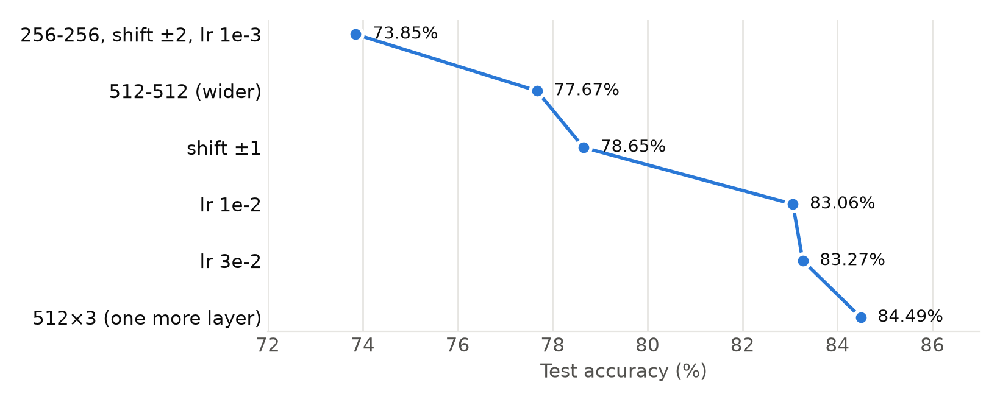
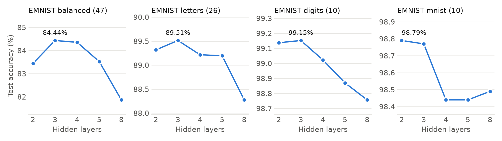
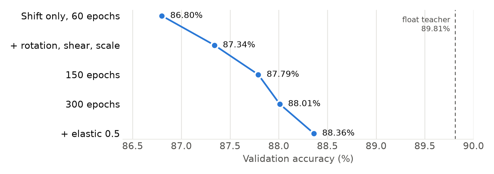
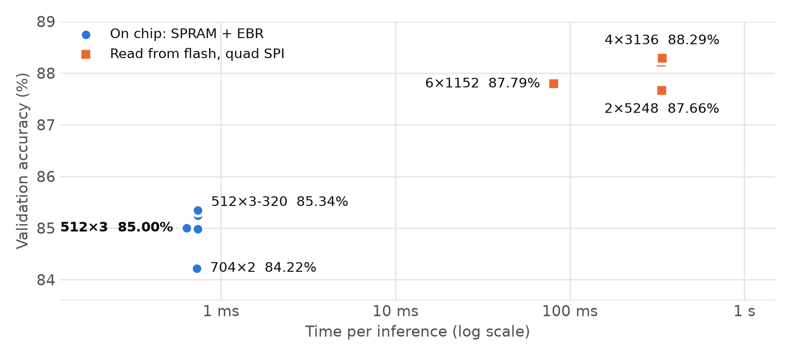
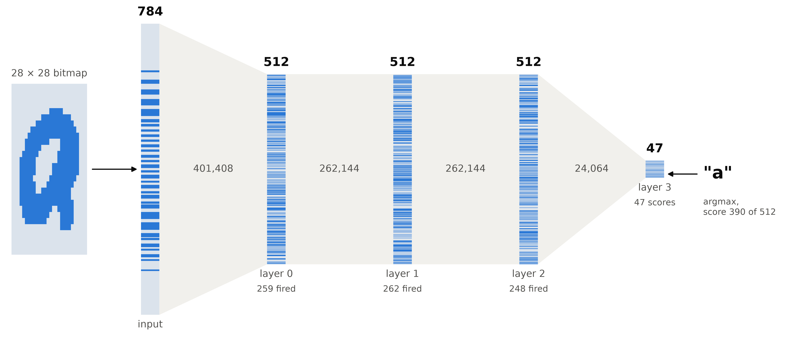
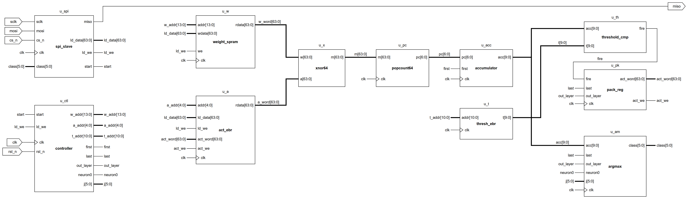

For the E155 final project, a user writes a character on a touchpad. An MCU turns the stroke into a bitmap and sends it over SPI to an iCE40 UP5K, and the FPGA classifies it.

This post covers how I chose the network, including the flash and EBR models I tried and dropped, and the hardware I plan to build around it. I worked through this with Claude Code, which ran the experiments with me.

The RTL doesn't exist yet. Accuracy numbers are measured in software. Hardware numbers are estimates from the architecture, and the module and signal names are proposals.

| | |
|---|---|
| Network | 784→512→512→512→47, fully binary |
| Dataset | EMNIST balanced, 47 classes |
| Test accuracy | 84.4% mean over 3 seeds (saved model: 84.49%) |
| Weight storage | 974,336 bits, 93% of SPRAM |
| Total EBR | 7 of 30 blocks, none for weights |
| Inference (estimate) | 15,224 memory reads, about 634 µs at 24 MHz |

## Why binary

The UP5K has about 5,300 LUTs, 120 Kbit of EBR, 1 Mbit of SPRAM, and 8 DSPs. A normal network doesn't fit that budget comfortably.

A binarized neural network stores every weight and activation as one bit, where 1 means +1 and 0 means -1. Multiplying two of those values is an XNOR, and summing the products is a popcount.

BatchNorm followed by sign folds into one integer compare per neuron, so each layer needs only XNOR, popcount, and compare. That idea comes from [Hubara et al.](https://arxiv.org/abs/1602.02830), and the threshold folding comes from [FINN](https://arxiv.org/abs/1612.07119).

## How I settled on the network

The search went through four memory budgets. Each one asked how much accuracy more memory could buy, and what it would cost in time.

| Stage | Budget | Best result |
|---|---|---|
| SPRAM only | 1 Mbit | 512×3: 84.4% test |
| Flash, under 100 ms | About 8 Mbit read per inference | 6×1152: 88.36% validation |
| Flash, no time limit | 32 Mbit chip | 4×3136: 88.29% validation at 150 epochs |
| SPRAM plus EBR | 17,664 words | 512×3-320: 85.34% validation at 150 epochs |

I ended up back at the first row. Shorthand: 512×3 means three hidden layers of 512, and 512×3-320 adds a fourth hidden layer of 320.

{fig-alt="Dot plot rising from 73.85 percent for the 256-256 model to 84.49 percent for the 512 by 3 model."}

### Starting too small

The first model, 784→256→256→47, reached 73.85%. It picked its best epoch on the test set, so that reads slightly high. Every later run uses a 10% validation split held out of the training set.

Its log had a useful clue: training accuracy was 69.9% while test accuracy was 73.5%. Training accuracy below test accuracy means the model can't fit the data, and it was using only 28% of SPRAM. So I started spending memory.

### Width, shift, and learning rate

Going to 512-512 made the model overfit without augmentation. A small random shift fixed that:

| Random shift | Train | Val | Test |
|---|---|---|---|
| None | 81.8% | 77.4% | 76.7% |
| ±1 px | 77.4% | 79.1% | **78.6%** |
| ±2 px | 74.8% | 78.2% | 77.7% |

Learning rate was the largest single gain. My best guess at why: a latent weight only changes the output when it crosses zero, and at 1e-3 too few of them do. I didn't test that directly.

| Learning rate | Epochs | Val | Test |
|---|---|---|---|
| 1e-3 | 60 | 79.1% | 78.6% |
| 3e-3 | 60 | 82.4% | 82.2% |
| 1e-2 | 60 | 82.9% | 83.1% |
| 1e-2 | 120 | 83.2% | 82.6% |
| **3e-2** | 60 | 83.3% | **83.3%** |

### Filling SPRAM: width or depth?

Next I asked whether nearly all of SPRAM is better spent on wide layers or more layers. Each configuration ran on four EMNIST splits:

{fig-alt="Four line charts of test accuracy against 2, 3, 4, 5, and 8 hidden layers. Three datasets peak at 3 layers and mnist peaks at 2, and accuracy falls at 8 layers except on mnist."}

| Hidden layers | SPRAM (47 classes) | Balanced | Letters | `digits` | `mnist` |
|---|---|---|---|---|---|
| 512-512 | 68% | 83.27% | 88.47% | 98.94% | 98.65% |
| 640-640 | 93% | 83.45% | 89.32% | 99.14% | **98.79%** |
| **512×3** | 93% | **84.44%** | **89.51%** | **99.15%** | 98.77% |
| 448×4 | 95% | 84.36% | 89.22% | 99.02% | 98.44% |
| 384×5 | 88% | 83.53% | 89.20% | 98.87% | 98.44% |
| 320×8 | 95% | 81.87% | 88.28% | 98.76% | 98.49% |

Three layers won or tied everywhere. Past that, each layer has to get narrower to fit, and 320×8 loses 2.6 points on balanced with no overfitting (82.1% train, 81.9% test).

`digits` ran 30 epochs instead of 60, because it has four times the images of `mnist`. I only tuned the learning rate on two layers, so 3e-2 may not suit the deepest models.

Repeat runs of 512-512 landed between 82.8% and 83.3%. That half point of noise is the size of many gaps above, so I ran the two front-runners with three seeds:

| Hidden layers | Seed 1 | Seed 2 | Seed 3 | Mean test |
|---|---|---|---|---|
| **512×3** | 84.66% | 84.49% | 84.14% | **84.43%** |
| 640-640 | 83.43% | 83.64% | 83.61% | 83.56% |

The worst 512×3 run beat the best 640-640 run on both validation and test, at the same SPRAM use.

### Moving the weights to flash

Then I asked what happens if every weight stays in flash and streams in during inference. Quad SPI at 24 MHz moves 96 Mbit/s, so an 8 Mbit read takes about 83 ms, inside the 100 ms goal.

These runs use the same settings as the SPRAM sweep. Read time counts padded weights and 16-bit thresholds. The numbers are test accuracy from one run each:

| Hidden layers | Flash read | Time | Balanced | Letters | `digits` |
|---|---|---|---|---|---|
| 512×3 (baseline) | 1.0 Mbit | 10.4 ms | 84.44% | 89.51% | 99.15% |
| 2×2432 | 8.13 Mbit | 84.7 ms | 85.64% | 90.76% | 99.25% |
| 3×1792 | 8.08 Mbit | 84.2 ms | 86.05% | 91.04% | **99.28%** |
| 4×1472 | 7.89 Mbit | 82.2 ms | 86.40% | 91.05% | 99.23% |
| 5×1280 | 7.78 Mbit | 81.1 ms | 86.41% | **91.15%** | 99.22% |
| **6×1152** | 7.76 Mbit | 80.8 ms | **86.50%** | 90.79% | skipped |
| 8×1024 | 8.37 Mbit | 87.2 ms | 86.01% | 90.97% | skipped |
| 3072-1536-768 | 8.58 Mbit | 89.3 ms | 85.99% | 91.05% | skipped |
| 2048-2048-1024 | 8.13 Mbit | 84.6 ms | 86.01% | 91.12% | skipped |

Eight times the memory bought about 2 points on balanced, 1.6 on letters, and 0.1 on `digits`. Most shapes landed within half a point of each other, which is run-to-run noise, and tapering showed no benefit.

Depth at a fixed width told the same story. On balanced at width 512, accuracy peaked around 4 layers. I stopped the sweep at 12:

| Depth | Flash read time | Test |
|---|---|---|
| 2 | 7.6 ms | 83.27% |
| 3 | 10.4 ms | 84.44% |
| **4** | 13.2 ms | **84.71%** |
| 6 | 18.9 ms | 84.59% |
| 8 | 24.5 ms | 84.27% |
| 12 | 35.7 ms | 83.77% |

The big models overfit by 4 to 6 points, so I tried a stronger shift. Train accuracy fell and test accuracy stayed put:

| Model | Shift | Train | Val | Test |
|---|---|---|---|---|
| Balanced, 6×1152 | ±1 px | 90.6% | 86.8% | **86.50%** |
| | ±2 px | 88.5% | 86.8% | 86.47% |
| | ±3 px | 87.3% | 86.9% | 86.35% |
| Letters, 5×1280 | ±1 px | 96.2% | 92.2% | 91.15% |
| | ±2 px | 94.4% | 92.6% | **91.18%** |

### A better training recipe

Up to here I had compared shapes on test accuracy, which is a mistake when you're picking a winner. From this point on, every choice uses the validation split.

Shifting was also the only distortion I had tried. I wrote a new trainer, `train_best.py`, that keeps the dataset on the GPU and distorts each grayscale image before thresholding it. It uses the same network and export code, so the hardware doesn't change.

Its baseline matched the old pipeline at 86.8% validation for 6×1152. Then each change stacked on the last:

{fig-alt="Dot plot rising from 86.80 percent with shift only to 88.36 percent with affine distortion, 300 epochs, and elastic distortion, with a dashed line at 89.81 percent for the float teacher."}

The distortions are rotation and shear up to ±10°, scale up to ±10%, and shift up to ±2 px. Elastic 0.5 adds a smooth random warp of about half a pixel. That recipe added 1.56 points to the same 7.76 Mbit network.

Four other ideas did little or nothing:

- Stronger distortion: elastic 1.0 scored 86.82% at 60 epochs. Rotation of ±15° with elastic 1.5 fell to 84.70%, and the samples were barely legible.
- Lower input threshold: thresholds of 0.35 and 0.25 scored 86.77% and 86.78%, against 86.82% at 0.5.
- Distillation from a float CNN: 87.37% to 87.57% at 60 epochs against 87.34%, and 87.92% against 87.79% at 150. That's one seed each, for about three times the training time.
- Recomputing BatchNorm statistics on clean images: it beat the saved model once in the runs I tried, by 0.04 points.

The float teachers reached 89.81% on balanced, 94.89% on letters, and 99.75% on `digits`, which gives a rough ceiling for this data.

### Using the whole flash chip

My board is a UPduino with a W25Q32JV, which is 32 Mbit (the 4 MB on the UPduino site is the same number). With no time limit, capacity is the only constraint: 33.55 million bits, less about 0.85 million I reserved for the bitstream.

| Hidden layers | Size | Quad SPI read | Val (150 epochs) |
|---|---|---|---|
| 2×5248 | 32.32 Mbit | 337 ms | 87.66% |
| 3×3776 | 32.02 Mbit | 334 ms | 88.21% |
| **4×3136** | 32.46 Mbit | 338 ms | **88.29%** |

At the same 150 epochs, 6×1152 scored 87.79%. Four times the memory added 0.5 points. I planned 5, 6, and 8 layer versions but didn't finish them, and none of these got the 300-epoch recipe.

### Filling SPRAM and EBR

The last budget uses every on-chip block. SPRAM holds 16,384 words, and four EBR blocks add 256 more 64-bit words. Thresholds and activations need EBR too, so only so much can overflow.

These runs used the affine recipe at 150 epochs. The EBR column includes thresholds and activations:

| Hidden layers | Words | EBR blocks | Inference | Val |
|---|---|---|---|---|
| **512-512-512-320** | 17,643 | 29 | 735 µs | **85.34%** |
| 576-576-512 | 17,656 | 28 | 736 µs | 85.24% |
| 512-512-512 | 15,224 | 7 | 634 µs | 85.00% |
| 576-512-448-256 | 17,660 | 28 | 736 µs | 84.98% |
| 704-704 | 17,413 | 27 | 726 µs | 84.22% |

Two wide layers clearly lost. The top four are within half a point of each other.

### The decision

I went back to 784→512→512→512→47, with every weight in SPRAM.

{fig-alt="Scatter plot on a log time axis. On-chip models sit near 0.7 milliseconds between 84.22 and 85.34 percent. Flash models sit at 81 and about 335 milliseconds between 87.66 and 88.29 percent."}

| | 512×3 | 512×3-320 | 6×1152 | 4×3136 |
|---|---|---|---|---|
| Weights live in | SPRAM | SPRAM + EBR | Flash | Flash |
| Val at 150 epochs | 85.00% | 85.34% | 87.79% | 88.29% |
| Inference | 634 µs | 735 µs | 80.8 ms | 338 ms |
| Time vs. 512×3 | 1× | 1.2× | 127× | 533× |
| Extra hardware | None | EBR weight read path | Flash read path | Flash read path |

Flash buys about 2.8 to 3.3 points, and 6×1152 still meets the 100 ms goal, so this was a real trade. With the weights in SPRAM, inference finishes in under a millisecond and never touches flash.

That also avoids a question I haven't answered: whether the flash's IO2 and IO3 pins reach the FPGA. On one lane, 8 Mbit would take 333 ms.

512×3-320 lost on cost. Its 0.34-point validation lead is smaller than the noise I measured, and it needs 22 more EBR blocks plus a second weight read path, leaving one block spare.

It did score 84.86% on the test set, 0.43 above the 512×3 mean. That's one seed from a newer recipe, so the two numbers don't compare directly.

512×3 is also the only option here with a three-seed mean, exported memory images, and traced vectors.

Some limits on this result:

- The saved model uses the older recipe: ±1 px shift for 60 epochs. Its validation score is 84.73%, and the same shape reached 85.00% with the newer recipe at 150 epochs.
- That newer 512×3 run has no test score, so the numbers in this post stay with the saved model.
- The 300-epoch recipe with elastic distortion hasn't been run at this size.

Apart from the 512×3-320 checkpoint, no model from the new recipe has a test score.

## The network

{fig-alt="A 28 by 28 bitmap of the letter a unrolls into a 784-cell column, which narrows through columns of 512, 512, 512, and 47 cells. The hidden layers fire 259, 262, and 248 neurons, and argmax picks a with score 390 of 512."}

Training uses real-valued latent weights clipped to [-1, 1]. The forward pass takes their sign, and the backward pass uses a straight-through estimator. BatchNorm has its scale fixed at +1, so BatchNorm plus sign is always a `>=` compare.

The output layer skips the threshold, which would throw away the ranking between classes. Argmax compares the raw popcounts instead. Softmax doesn't change their order, so the hardware picks the same class as the Keras model.

The integer reference model scores 84.49% on the saved model and agrees with Keras on all 18,800 test images. That doesn't test any hardware yet, but the RTL now has one exact target.

## Timing and storage

Each neuron's inputs pad up to a whole number of 64-bit words:

| Layer | Inputs | Neurons | Words per neuron | Words read |
|---|---|---|---|---|
| 0 | 784 | 512 | 13 | 6,656 |
| 1 | 512 | 512 | 8 | 4,096 |
| 2 | 512 | 512 | 8 | 4,096 |
| 3 | 512 | 47 | 8 | 376 |
| **Total** | | | | **15,224** |

Where everything goes:

| Item | Size | Location |
|---|---|---|
| Weights, 15,224 words | 121.8 KB | 4 SPRAM blocks, 93% full |
| 1,536 thresholds | 16-bit entries | 6 EBR blocks |
| Activations | Two banks | 1 EBR block |

That leaves 1,160 SPRAM words and 23 EBR blocks free.

| Step | Time |
|---|---|
| Boot: load 124.9 KB over SPI at 5 MHz | 200 ms, once |
| Send a 98-byte bitmap | 157 µs |
| Inference: 15,224 cycles at 24 MHz | 634 µs |
| Read the class back | 1.6 µs |

That's about 0.8 ms per character. Accuracy cost time here: the original 256-256 model needed about 190 µs, so the proposal's inference limit moved from 200 µs to 700 µs.

## The hardware

{fig-alt="Block diagram of the proposed FPGA design with SPI slave, controller, weight SPRAM, activation EBR, threshold EBR, XNOR, popcount, accumulator, threshold compare, pack register, and argmax blocks."}

All four layers share one datapath. The controller runs this loop, reading one 64-bit weight word per cycle from the four SPRAM blocks in parallel:

```text
for each layer:
    for each neuron j:
        for each word k:
            acc += popcount(act[k] XNOR W[j, k])
        if output layer: keep acc if it beats the running max
        else:            shift (acc >= t[j]) into the next activation word
```

| Module | Job |
|---|---|
| `spi_slave` | Loads weights at boot, receives each image, returns the class |
| `controller` | Runs the loop and generates all addresses |
| `weight_spram` | Holds the weights in 4 SPRAM blocks, read as one 64-bit word |
| `act_ebr` | Holds activations in two banks, so each layer reads one and writes the other |
| `thresh_ebr` | Holds 1,536 thresholds |

SPRAM can't be initialized from the bitstream the way EBR can, so the weights have to arrive over SPI at boot.

## Each module in binary

These values are real. They follow the first test image, a lowercase "a", through the saved model, taken from the same `.mem` files the testbench will use. Every number below matches the integer reference model.

### XNOR

{fig-alt="Three of the 64 XNOR gates, each combining one bit of the weight word and one bit of the activation word into one bit of the match word." width=60%}

A 1 in the output means the input bit and the weight bit agree. This is word 6 of neuron 0 in layer 0:

```text
a  0000111111111100 0000111110000001 1111111110000001 1111100000011111
w  0001001011110000 0011101111110010 1111111111010001 0011111100010111
m  1110001011110011 1100101110001100 1111111110101111 0011100011110111
```

784 isn't a multiple of 64, so the last word has 48 padding bits. Input padding is 0 and weight padding is 1, which makes the XNOR 0. Padding never adds to a count, so the thresholds need no correction.

In word 12 the top 48 bits of `m` are all 0:

```text
m  0000000000000000 0000000000000000 0000000000000000 1101111111110000
```

### Popcount

{fig-alt="Six levels of adders reducing 64 bits to a 7-bit count, with a pipeline register after level 3."}

The tree adds neighboring bits, then neighboring sums. Here it is on the low byte of `m` from word 6:

```text
input     11 11 01 11     8 bits
level 1   10 10 01 10     2, 2, 1, 2
level 2   100  011        4, 3
level 3   0111            7
```

All 64 bits of that word sum to 42, or `0101010`. The result needs 7 bits, because a word where every bit matches gives exactly 64.

### Accumulator

{fig-alt="An adder feeds a mux selected by first, into a 10-bit register whose output feeds back to the adder."}

Neuron 0 reads 13 words:

| Word | 0 | 1 | 2 | 3 | 4 | 5 | 6 | 7 | 8 | 9 | 10 | 11 | 12 |
|---|---|---|---|---|---|---|---|---|---|---|---|---|---|
| Popcount | 32 | 33 | 41 | 39 | 43 | 38 | 42 | 21 | 24 | 27 | 36 | 27 | 11 |
| Running sum | 32 | 65 | 106 | 145 | 188 | 226 | 268 | 289 | 313 | 340 | 376 | 403 | 414 |

The final sum is 414, or `0110011110`. Layer 0 can reach 784, so the accumulator is 10 bits wide.

### Threshold and pack

{fig-alt="A greater-or-equal comparator produces fire, which shifts into a 64-bit register enabled on the last word of hidden layers. A counter raises act_we every 64 neurons."}

For a layer with N inputs, the folded threshold is `ceil((T + N) / 2)`, where `T = mean - beta * sqrt(var + eps)`. One neuron stays off and a later one fires:

```text
neuron 0   acc 0110011110 (414)   t 0110100110 (422)   fire = 0
neuron 2   acc 0111011111 (479)   t 0111010110 (470)   fire = 1
```

Bits enter at the top of the shift register, so after 64 neurons the first neuron sits in bit 0. That matches how the next layer reads its input.

The first 64 neurons of layer 0 pack into `0x2df98e5cf148f52c`. Its low byte is `00101100`, which is neurons 2, 3, and 5 firing. Across the whole layer, 259 of 512 neurons fire for this image.

### Argmax

{fig-alt="A comparator and gates produce load, which enables a 10-bit max register and a 6-bit index register."}

Two details keep this identical to `np.argmax`. The compare is strict, so a tie keeps the earlier class. Class 0 always loads, so the reset value of the register can't beat a real score.

For this image the register loads six times:

```text
class    score                  index
0        0100010110  (278)      000000
2        0100010111  (279)      000010
9        0100101001  (297)      001001
C        0100101100  (300)      001100
Q        0101010000  (336)      011010
a        0110000110  (390)      100100
```

The FPGA would return class 36, "a", which is correct. The next best scores were g at 346 and q at 340.

## Training setup

I set up `project/BNN` so that one Makefile runs the original flow: `make data`, `make train`, `make vectors`, and `make sim`. `make vectors` writes the memory images plus a traced set of 16 images with every layer's popcounts and activations, for debugging the RTL layer by layer.

`train_best.py` sits beside that flow. `mem/` and `vectors/` hold the final 512×3 model.

TensorFlow has no GPU support on native Windows, so I ran it in WSL2 on an RTX 4060 Laptop GPU. This is the same 512-512 training, 60 epochs, on an idle machine:

| | GPU | CPU |
|---|---|---|
| Total time | 2m 48s | 4m 24s |
| Time per step | 5 ms | 10 ms |
| Test accuracy | 82.77% | 82.82% |

That first pipeline was limited by overhead, and the GPU sat around 40% utilization during the sweep. Compiling the training step with XLA took a 6×1152 step from 21.6 ms to 4.75 ms in my profile. After that, on-chip models trained for 150 epochs in about a minute, and a 32 Mbit model took under 10 minutes.

## Alternatives I looked at

I also compared two other architectures on paper, using published results. Neither has been trained here, so these are estimates:

| | 512×3 MLP | mnist64-style binary CNN | Small int8 CNN |
|---|---|---|---|
| Letters accuracy | 89.5% (measured) | About 90-93% | About 93-95% |
| Weights | 974 Kbit | 128 Kbit | 315 Kbit |
| New hardware | None | Window address generator | DSP MAC array, requantizer |

The convolutional options use far less memory and could score higher. The cost is a more complex datapath to design and verify. Measuring them in Keras comes before any decision to switch.

## What I've learned

- Read the training log before changing anything. Training accuracy below test accuracy told me the model was too small.
- Try the learning rate early. I tuned it third, and going from 1e-3 to 3e-2 added 4.6 points.
- Measure your noise before ranking results. I first estimated ±0.3 points from test set size alone, and repeat runs showed about 0.5.
- Pick winners on validation. Seed 1 of 512×3 had the best test score, and choosing it would have flattered the result.
- Memory stopped being the limit early. Going from 1 Mbit to 8 gave about 2 points, and from 8 to 32 gave 0.5. A better training recipe gave 1.56 points with no hardware change.
- A failed idea can still be a clue. Stronger shift didn't help, but the overfitting it targeted did respond to rotation, shear, and scale.
- A distortion can need time to pay off. Elastic 0.5 only tied affine alone at 60 epochs, then won by 0.35 points at 300.
- Silent fallbacks look like success. My first GPU check printed OK because TensorFlow quietly ran the test on the CPU. The check now fails unless the work runs on the GPU.
- Integer math in NumPy is slow. Generating vectors was on track for about 15 minutes, because int64 matrix multiplies skip BLAS. Switching to float32 is exact here, since every sum is at most 784, and the step dropped to 43 seconds.
- Stopping a job doesn't always stop it. When I killed a training run, its shell loop marked it done and started the next one. The script now only marks a run done if it exited cleanly.
- Laptops sleep. My queue stalled three times: once when the battery hit critical, and twice, as far as I can tell, on the 30-minute idle timeout, which applies even when plugged in.
- Check what the dataset says about itself. TensorFlow Datasets declares 37 classes for EMNIST letters, while the labels only run from 1 to 26. A letters model for the FPGA should drop those 11 unused outputs.

## What's next

Next is the hardware: the datapath and controller in simulation, checked layer by layer against the traced vectors, then the SPI weight load, then synthesis to see real LUT usage and clock speed.

Then I need to measure real input. The proposal targets 80% over 50 trials, and 84.4% on EMNIST clears that on paper.

Finger strokes on a touchpad look different from scanned handwriting, so demo accuracy could land on either side of 80%, and the MCU's cropping and scaling will matter. After the argmax, a lookup table can map each lowercase class to its capital, which should help on look-alike pairs.

A retrain is also available at no hardware cost. A 512×3 model from the newer recipe has the same memory map, so it could replace the weights if it holds up over several seeds and on letters and `digits`.

## Sources

- Hubara et al., [Binarized Neural Networks](https://arxiv.org/abs/1602.02830), NeurIPS 2016
- Umuroglu et al., [FINN: A Framework for Fast, Scalable Binarized Neural Network Inference](https://arxiv.org/abs/1612.07119), FPGA 2017
- Rastegari et al., [XNOR-Net](https://arxiv.org/abs/1603.05279), ECCV 2016
- Cohen et al., [EMNIST: an extension of MNIST to handwritten letters](https://arxiv.org/abs/1702.05373), 2017
- [jarnoh/mnist64](https://github.com/jarnoh/mnist64), the binary CNN in the comparison above
- Lattice FPGA-TN-02022, iCE40 SPRAM Usage Guide
- Lattice FPGA-TN-02002, Memory Usage Guide for iCE40 Devices
