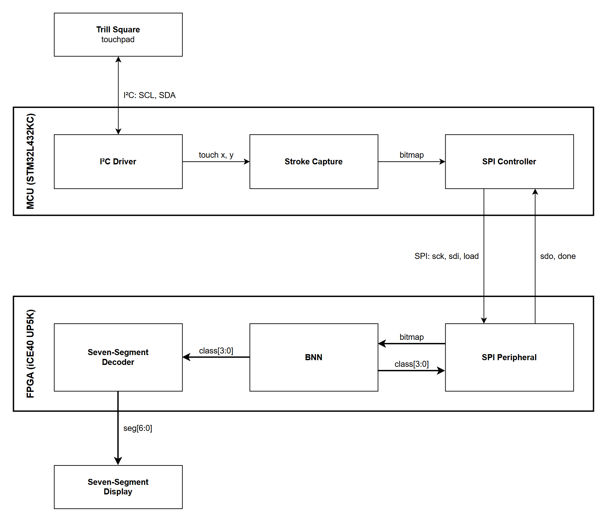

**Team:** Pierce Clark, Luke Murphy

## Project overview

The proposed device will translate fingerstrokes on a touchpad into letters on a hex-segment display. On demo day, people will be able to write to the seven-seg display using just their fingers to draw letters or numbers on the touchpad.

To achieve this, the MCU will continuously sample the touchpad for inputs using I2C. The MCU will stream the touch data to the FPGA on completion of a keystroke. The FPGA will run a binarized digit classification model on the data to determine which letter to write to the hex-segment display. The predicted character will be shifted onto the displays for the user to see.

## Specifications

At the demo, the hardware of the project will:

- Scan the touchscreen at 100 Hz for inputs.
- Classify all 26 letters and 10 numbers from live sensor data
- Have an accuracy rate of 80% over 50 trials.
- Produce the result within 100 ms of the completed input
- Display the result on the seven-segment display at 90 hz (no visible flickering)
- Only displayable letters/numbers are shown. Ineligible characters are represented with a single dash (through segment G).
- Consecutive characters are properly shifted along a segmented display array.

## Subsystems

### MCU (STM32L432KC)

The MCU reads the finger position from the Trill Square using I2C. When the letter is done being written, it turns the stroke into a 28×28 bitmap. It sends the bitmap to the FPGA over SPI.

- **Peripherals used:** I2C (touchpad), SPI (FPGA), timer (100 Hz sampling), GPIO interrupts (FPGA done, submit button),
- **Firmware structure:** Timer-driven sampling loop

### FPGA (iCE40 UP5K)

The FPGA will act both as the inference accelerator and display controller for the overall system. It receives a 784-bit bitmap from the MCU over SPI and runs into a binarized neural network or BNN (implemented as a custom datapath) to classify it as one of 47 EMNIST classes (0-9, A-Z, and 11 lowercase letters). The classified character is then decoded to a 14-segment pattern and shown on a multiplexed display.

\*The BNN uses no multiplier, as each neuron XNORs the input with the stored weights, counts the matches (popcount), and then compares the count to a trained threshold.

Tasks)

- At boot: read MCU stream of weights and trained thresholds over SPI and write them into an on-chip SPRAM, and EBR respectively.
- For each character: receiver 784 bit bitmap over SPI into an input register’
- Run a 4-layer BNN (784→512→512→512→47), reading 64 weight bits per clock cycle from the 4 SPRAM blocks
- Select highest score of the final 47 neurons (argmax)
- Decode the output to a 14-segment pattern and drive the multiplexed display.
- Return the class index to the MCU over MISO for UART logging.

Peripherals Used: SPI (MCU), SPRAM (MCU writes weights into upon booting), EBR (storing offline calculated thresholds)

- Modules: SPI peripheral, input bitmap register, SPRAM weight holder, layer sequencer  FSM, output 14-segment LUT, display multiplexer

- Resources: 4 SPRAM blocks read in parallel (weights), 6 EBR (thresholds), 0 DSP blocks, \<30% of 5,280 LUTs; 24 MHz clock from the internal HSOSC; inference ≤ 700 µs.

## New hardware

The project uses one new MCU peripheral, one new FPGA IP, and one new external device.

| **Category** | **Item** | **Role in this project** |
|---|---|---|
| New MCU peripheral | I2C1 | Communicates with touch pad |
| New FPGA IP | SPRAM | Storage of weights |
| New external hardware | Trill Square Rev C | Detects touch input from users |

## Block diagram

## Performance calculations

The MCU polls the Trill Square over I²C every 10 ms (100 Hz). That is longer than the sensor's 6.15 ms full scan and uses under 10% of the 400 kbit/s bus.

The MCU and FPGA share one SPI link at 5 MHz. That is under a quarter of the FPGA's 24 MHz clock, so the FPGA can sample SCK through a synchronizer, and one data line is fast enough. Each character takes about 159 µs of SPI time: 157 µs to send the 784-bit bitmap and 1.6 µs to read the class index back over MISO.

The BNN (784→512→512→512→47) reads its 949,760 binary weights 64 bits per cycle and finishes in 15,224 cycles (634 µs). It scores 84.4% on the EMNIST Balanced test set across all 47 classes (mean of 3 seeds). We have not measured accuracy on touchpad input yet. Loading 124.9 KB of weights and thresholds at boot takes 200 ms.

A 500 ms end-of-character timeout dominates end-to-end latency, which is at most 600 ms from finger lift to display. Estimated system power is 0.35 W, mostly from the multiplexed displays.

| Parameter | Value |
|---|---|
| Touch sample rate | 100 Hz (I²C, 9.5% bus load) |
| SPI link (MCU to FPGA) | 5 MHz, 1 data line (under ¼ of the 24 MHz FPGA clock) |
| Bitmap transfer | 98 B in 157 µs @ 5 MHz SPI |
| Boot weight load | 124.9 KB in 200 ms |
| Inference | 949,760 binary ops, 15,224 cycles, 634 µs @ 24 MHz |
| Model accuracy | 84.4% test (mean of 3 seeds), EMNIST Balanced, 47 classes |
| SPI time per character | ≈ 159 µs (157 µs bitmap in, 1.6 µs class index out) |
| FPGA memory | 121.8 KB weights in SPRAM (93%), 6 EBR for thresholds |

**Riskiest element**

The riskiest element of this project will be the BNN. Fitting the model in the FPGA may be a challenge. Our model should be maximized to the size of the FPGA’s memory blocks, so we can get as accurate of a model as possible..

Additionally, training the model is a major bottleneck that needs to be overcome for the project to succeed. If the model is inaccurate or cannot fit, then we will have to find another way to classify user input. Additionally, we need to develop the understanding of how a BNN works in order to implement the logic correctly.

Testing the BNN will be hard because it is a black box. Developing a rigorous testing plan and having a reference model of the BNN in code will help us measure the hardware against simulated results.

## Scheduled Work and Project Breakdown)

[Gantt chart](https://docs.google.com/spreadsheets/d/1Ezt3dacDeXingCH_D66IfCKbtVyyRdMZJSXwZwZAFqY/edit?gid=0#gid=0)

## Bill of materials

| Part | Part number | Qty | Unit price | Source |
|---|---|---|---|---|
| MCU dev board | \[STM32L432KC Nucleo\] | 1 | Stockroom | Stockroom |
| FPGA board | \[iCE40 UP5K board\] | 1 | Stockroom | Stockroom |
| Trill Square Rev C | [160702-SQUARE](https://www.mouser.com/catalog/specsheets/Bela_02-14-2025_TRILL_sensors_datasheet-3359251.pdf) | 1 | \$27.00 (\$19.00 + \$8.00 shipping) | https://www.crowdsupply.com/bela/trill |
| 14-segment alphanumeric display | COM-21214 | 4 | \$23.13 (\$14.64 +  \$8.49 Shipping) | https://www.digikey.com/en/products/detail/sparkfun-electronics/COM-21214/16892534 |
| Miscellaneous Components | PNP Transistor NPN Transistor Segment current limiting resistors Transistor base resistors Decoupling Caps Breadboards Jumper Wires | N/A | Stockroom | Stockroom |
| **Total** | | | **\$50.13** | |

*Hint: every row needs a part number, quantity, and price or "stockroom". See [Purchasing Parts](https://hmc-e155.github.io/project/assignments/purchasing-parts.html).*
